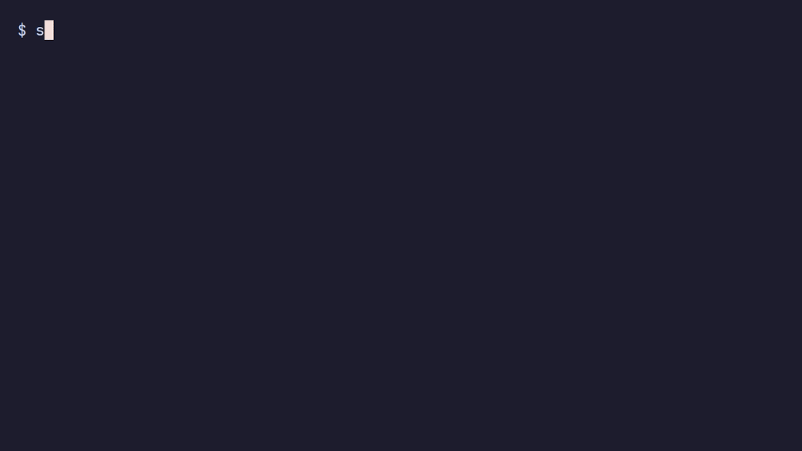
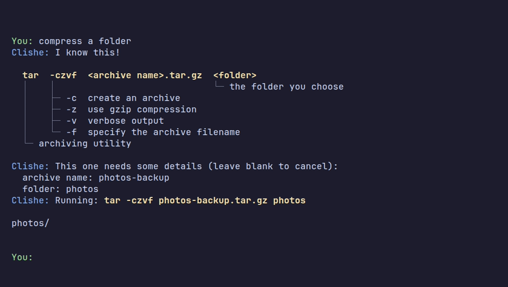
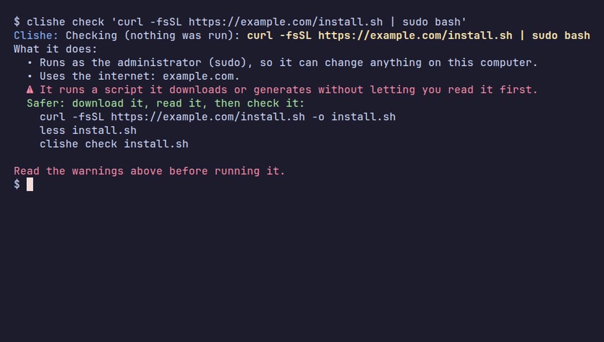
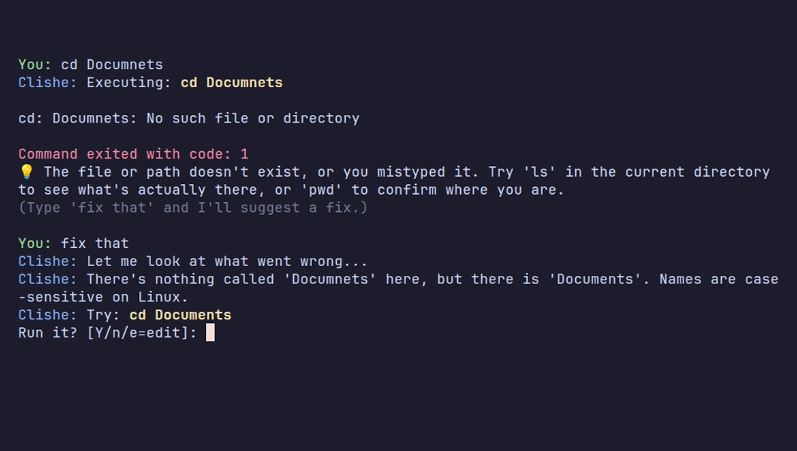
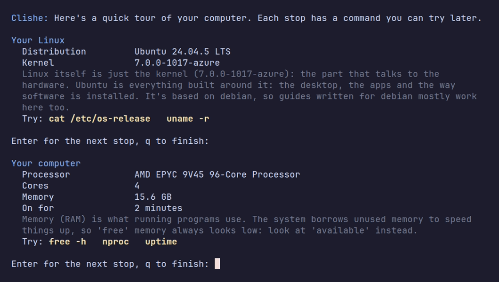

<div align="center">

# Clishe

**Say what you want. Learn the command. Keep your shell.**

An offline-first command-line companion for Linux beginners.
Type plain English, get a real shell command, and see exactly what will run before it does.
AI assistance is optional, and when you use it, it runs on your own machine.

[](https://github.com/Sym-jay/clishe/actions/workflows/tests.yml)


[Quick start](#quick-start) · [What it does](#what-it-does) · [Install](#install) · [Using it](#using-it) · [Docs](#learn-more) · [Contributing](#contributing)

</div>

---



Or skip the session entirely: type plain English at your **normal prompt** and press **Ctrl+G**. The words turn into the command, right there on your line, ready to read, edit and run.

```text
$ show me disk usage        ← press Ctrl+G
$ df -h                     ← press Enter when you're ready
```

## Quick start

```bash
pipx install clishe   # Linux or macOS (Windows: inside WSL)
clishe                # then type what you want, e.g. "show me disk usage"
```

Other ways to install are under [Install](#install).

## What it does

Most command-line tools assume you already know the command you want. Clishe assumes you don't, and treats that as normal.

- **Plain English in, real command out, offline**: your phrases, 100+ built-in ones and 31,000 tldr-pages examples, with "did you mean...?" when it's close. No account, no network.
- **Every part labelled**, so you see what each flag does before anything runs. `explain` does the same for any command, from your own man pages.
- **Ctrl+G in your normal shell** (bash, zsh or fish) turns a line of English into the command, without running it.
- **Safe by default**: destructive commands need a typed `YES` and say why; `rm` can go to the Trash; `undo that` reverses the last change.
- **`fix that`** explains a failed command and offers a fix, and **`clishe check`** says what a command or script would do before you run it.
- **Learn as you go**: after a few asks it's your turn to type it; `practice` lessons, your own cheat `sheet` and `progress`; `tour` explains your computer.
- **AI is optional and local** (Ollama, llama.cpp, LM Studio...). Nothing leaves your machine unless you turn on a cloud provider.
- **It learns from you**: what you teach or approve is remembered once it has worked. A command that fails is never saved.

| Each part labelled | Is this safe to run? |
|---|---|
|  |  |
| **fix that** | **clishe tour** |
|  |  |

Every feature, with examples: [Using Clishe](https://github.com/Sym-jay/clishe/blob/main/docs/usage.md).

## Install

**Requirements:** Linux or macOS, bash (any version, including the 3.2 that macOS ships) and Python 3.9+ (standard library only).

> **macOS:** works with the built-in bash, zsh and fish. Install hints use Homebrew, deleted files go to the Trash, and `clishe tour` explains your Mac. Most commands work the same as on Linux; where macOS's BSD tools differ, `explain` reads your Mac's own man pages. **Windows:** use [WSL](https://learn.microsoft.com/windows/wsl/install).

### With pipx (recommended)

[pipx](https://pipx.pypa.io) installs command-line tools in their own space, and most distros package it (`sudo apt install pipx`, `sudo dnf install pipx`, `sudo pacman -S python-pipx`). On a Mac: `brew install pipx`.

```bash
pipx install clishe
```

Update with `pipx upgrade clishe`. (`uv tool install clishe` works too, and `pipx install git+https://github.com/Sym-jay/clishe` gets the latest unreleased code.) There's also a man page: `man clishe`.

### With the install script

```bash
curl -fsSL https://raw.githubusercontent.com/Sym-jay/clishe/main/install.sh | bash
```

This needs git. It clones the repo into `~/.clishe-src` and links a `clishe` launcher into `~/.local/bin`. If that directory isn't on your `PATH`, the installer tells you what to add. To read the script first, [view install.sh](https://github.com/Sym-jay/clishe/blob/main/install.sh), or once you have Clishe, `clishe check install.sh`.

### From a clone

```bash
git clone https://github.com/Sym-jay/clishe.git
cd clishe
./clishe.sh
```

### Uninstall

```bash
pipx uninstall clishe                       # if you used pipx
rm -rf ~/.clishe-src ~/.local/bin/clishe    # if you used the install script
# Optional: also remove your saved data and config
rm -rf ~/.local/share/clishe ~/.config/clishe
```

## Using it

Start a session with `clishe` and type what you want. Type `help` for tips, and `exit` (or Ctrl-D) to leave.

For **Ctrl+G at your normal prompt**, add one line to your shell's startup file, then open a new terminal. It also turns on Tab completion for `clishe`.

```bash
eval "$(clishe --init bash)"   # in ~/.bashrc
eval "$(clishe --init zsh)"    # in ~/.zshrc
clishe --init fish | source    # in ~/.config/fish/config.fish
```

### Session commands

| Type | What it does |
|---|---|
| `help` | Show tips |
| `learned` | List the phrases you've taught |
| `teach` | Teach a phrase and its command, or fix a wrong one |
| `forget <phrase>` | Forget a phrase you taught |
| `practice [lesson]` | Hands-on exercises in a throwaway folder (`practice list` shows the lessons) |
| `progress` | The commands you've learned to type yourself |
| `setup` | Find or set up a local AI model |
| `tour` | A quick tour of your own computer |
| `doctor` | Check your setup, and how to fix anything wrong |
| `sheet` | Your own cheat sheet of the commands you've learned |
| `explain <command>` | Explain a command and its flags |
| `what does this mean` | Explain the output of the command you just ran |
| `fix that` | Explain why the last command failed, and offer a fix |
| `undo that` | Reverse the last change (shows the command first) |
| `check <command>` / `is this safe: <command>` | What a command or script would do, without running it |
| `exit` / Ctrl-D | Leave |

### One-shot mode

```bash
clishe explain "tar -xzvf"        # explain a command, then exit
clishe "show me disk usage"       # look up a phrase in your KB / seed KB (does not run it)
clishe --list                     # the phrases you've taught, tab-separated
clishe practice [lesson]          # hands-on exercises (--list shows the lessons)
clishe progress                   # what you've learned
clishe setup                      # find or set up a local AI model
clishe tour                       # a quick tour of your computer
clishe doctor                     # check your setup (exit 1 if something's broken)
clishe sheet                      # your cheat sheet (clishe sheet > cheatsheet.txt)
clishe check '<command>'          # is it safe to run? (or a script: clishe check setup.sh)
clishe orbs                       # the nine thinking orbs Clishe shows while it waits
clishe --init bash                # the Ctrl+G shortcut, for your ~/.bashrc
clishe --init zsh                 # the same, for your ~/.zshrc
clishe --init fish                # the same, for ~/.config/fish/config.fish (pipe it to source)
clishe --plain ...                # words instead of symbols and drawings (screen readers)
clishe --version
clishe --help
```

## Learn more

- [Using Clishe](https://github.com/Sym-jay/clishe/blob/main/docs/usage.md): every feature, with example sessions, and the Ctrl+G shortcut in detail.
- [Configuration](https://github.com/Sym-jay/clishe/blob/main/docs/configuration.md): where Clishe keeps its files, plain mode for screen readers, and every setting.
- [AI providers](https://github.com/Sym-jay/clishe/blob/main/docs/ai.md): `clishe setup`, Ollama, llama.cpp, LM Studio and the opt-in cloud provider.
- [How it works](https://github.com/Sym-jay/clishe/blob/main/docs/how-it-works.md): the steps Clishe takes, security, and the project layout.
- [Troubleshooting](https://github.com/Sym-jay/clishe/blob/main/docs/troubleshooting.md): start with `clishe doctor`.
- [Changelog](https://github.com/Sym-jay/clishe/blob/main/CHANGELOG.md) and [issues](https://github.com/Sym-jay/clishe/issues): what's new and what's planned.

## Contributing

Contributions are welcome, and there are [good first issues](https://github.com/Sym-jay/clishe/issues?q=is%3Aissue+is%3Aopen+label%3A%22good+first+issue%22), many of them data only. [CONTRIBUTING.md](https://github.com/Sym-jay/clishe/blob/main/CONTRIBUTING.md) covers where things go and how to test them:

```bash
pip install -e ".[dev]"
python -m pytest tests/ -q && ruff check .
bash tests/test_shell_functions.sh
```

**Security:** Clishe runs commands with `eval`, and its safety check is not exhaustive, so read what you're about to run and don't run it as root. Details: [How it works](https://github.com/Sym-jay/clishe/blob/main/docs/how-it-works.md#security). To report a way around the checks, see [SECURITY.md](https://github.com/Sym-jay/clishe/blob/main/SECURITY.md).

## License

MIT. See [LICENSE](https://github.com/Sym-jay/clishe/blob/main/LICENSE).

Command summaries and examples come from [tldr-pages](https://github.com/tldr-pages/tldr), © the tldr-pages team and contributors, [CC BY 4.0](https://creativecommons.org/licenses/by/4.0/). See [NOTICE.md](https://github.com/Sym-jay/clishe/blob/main/NOTICE.md) for details and what was changed.
