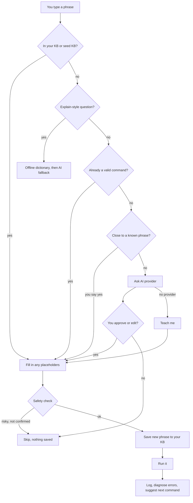

[← Back to the README](../README.md)

# How it works

- [The steps Clishe takes](#the-steps-clishe-takes)
- [Security](#security)
- [Project layout](#project-layout)

## The steps Clishe takes



## Security

Clishe runs resolved commands with `eval`, so it can do anything a shell command can. Please read this before trusting it.

- **You approve AI suggestions before they run**, and only what you approved (including your edits) is saved.
- **Destructive-looking commands need a typed `YES`,** with a plain-English reason. The check lives in `safety.py` and has its own test suite.
- **A phrase is saved only after its command passes the safety check** (or you confirm it), so cancelling a warning never leaves a risky command in your KB.
- **The check is not exhaustive.** It catches common ways to lose data, not every risky command (for example, anything hidden inside `$(...)` or a script you run). Read what you're about to run.
- **Don't run Clishe as root.** It's alpha software.
- If you use the config file for an API key, it's created with `0600` permissions. An environment variable avoids storing the key at all.

To report a way to bypass the confirmation checks, see [SECURITY.md](../SECURITY.md).

## Project layout

```text
clishe.sh               interactive shell front end
clishe-bind.bash        Ctrl+G shortcut for your normal bash prompt
clishe-bind.zsh         the same shortcut for zsh
clishe-bind.fish        the same shortcut for fish
clishe_brain.py         backend: KB, history, prediction, AI resolution
config.py               config loading, distro detection
knowledge.py            offline explain / diagnose engine
manual.py               reads the man pages installed on your system
breakdown.py            draws a command with each part labelled
tldr.py, tldr.json.gz   summaries and examples from tldr-pages (see NOTICE.md)
orbs.py                 the thinking orbs shown while Clishe waits (see NOTICE.md)
scripts/build_tldr.py   rebuilds tldr.json.gz from a tldr-pages release
tour.py                 clishe tour: your computer in plain English
doctor.py               clishe doctor: setup checks and how to fix them
apps.py, apps.json      "how do I install Spotify?": popular apps per distro
fix.py                  fix that: offline fixes for common mistakes
lessons.py, lessons/    practice lessons (JSON) and how they're checked
check.py                clishe check: what a command or script would do
undo.py                 undo that: notes before a change, and how to reverse it
safety.py               destructive-command check
setup_check.py          clishe setup: memory, local model servers, model suggestion
providers/              AI provider interface: Ollama, OpenAI-style local servers, Anthropic (opt-in)
seed_kb.json            bundled starter phrases (read-only)
command_dictionary.json offline command explanations
output_guides.json      offline "what does this mean?" guides
error_patterns.json     offline error hints
install.sh              one-line installer
launch.py               the clishe command when installed with pipx
clishe.1                the man page (man clishe)
packaging/aur/          Arch User Repository package
tests/                  pytest suite
```
