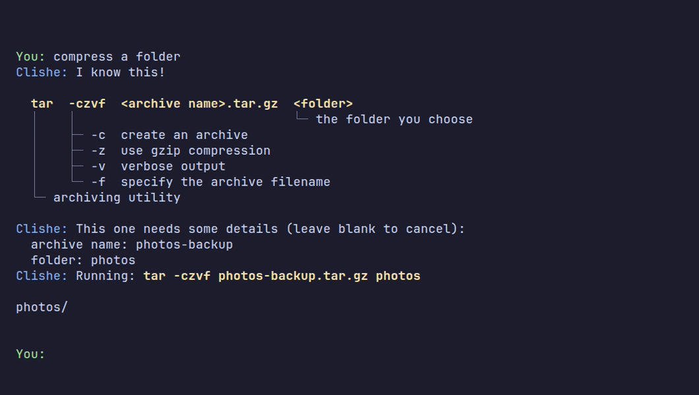
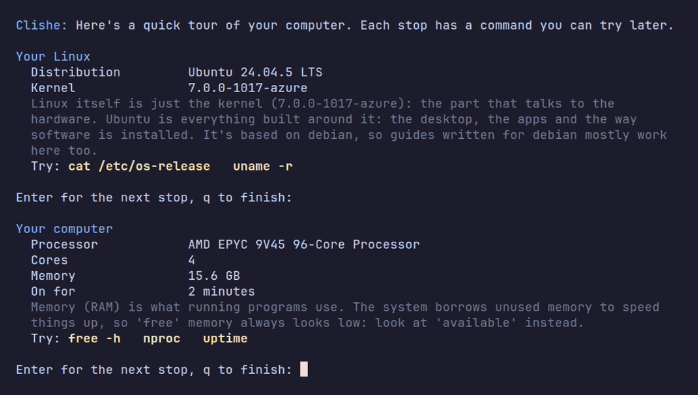
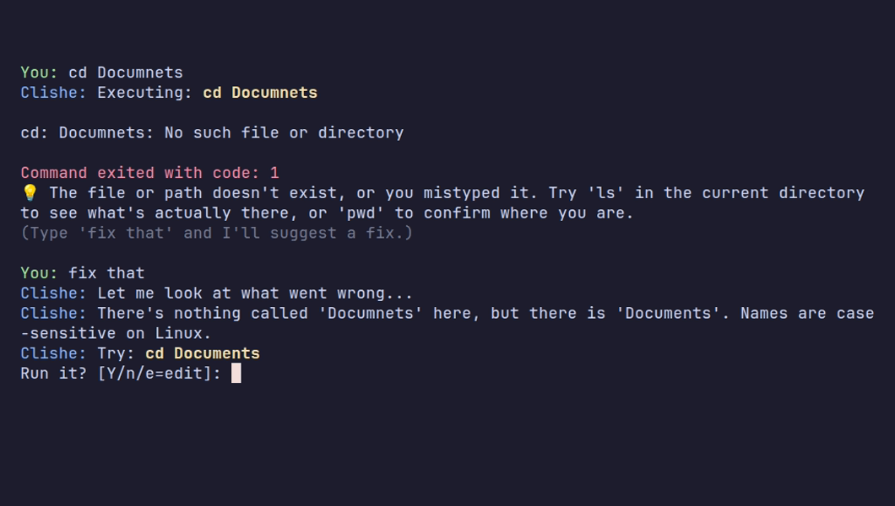
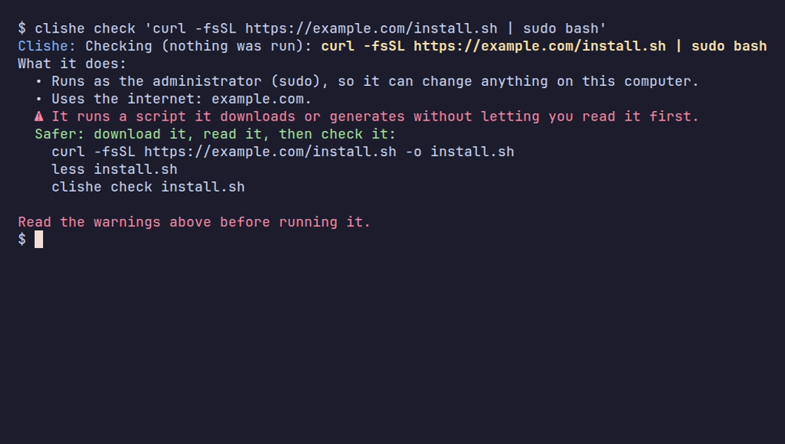

[← Back to the README](../README.md)

# Using Clishe

- [Session examples](#session-examples)
- [Your normal shell (Ctrl+G)](#your-normal-shell-ctrlg)
- [All features](#all-features)

Start a session with `clishe`, type what you want, `help` for tips and `exit` (or Ctrl-D) to leave.

## Session examples



**A phrase Clishe already knows**
```text
You: show me disk usage
Clishe: I know this! Running: df -h
```

**A phrase that needs details**
```text
You: copy a file
Clishe: I know this! cp <file> <destination>
Clishe: This one needs some details (leave blank to cancel):
  file: my notes.txt
  destination: backup/
Clishe: Running: cp 'my notes.txt' backup/
```
Values with spaces or wildcards are quoted for you. Leaving a value blank cancels.

**Close, but not exact**
```text
You: show disk usage
Clishe: Did you mean "show me disk usage"? That runs: df -h
Use it? [Y/n]: y
```
Saying yes also remembers your wording, so next time it's instant.

**A phrase it doesn't know, with an AI provider configured**
```text
You: find files bigger than 100MB
Clishe (via ollama): I think you mean:

  find  .  -type f  -size +100M
  │     │  │        └─ bigger than 100M
  │     │  └─ only files, not folders
  │     └─ this folder
  └─ search for files in a directory hierarchy

  Searches this folder and below for files larger than 100 MB.
  ✓ every option is in the manual
Run this? [Y/n/e=edit]: e
Edit command: find ~ -type f -size +100M
```
Your edited command is the one that gets run and saved. Answering `n` skips it and saves nothing. The suggestion above is illustrative, since the exact command depends on your model.

**A phrase it doesn't know, with no AI provider**
```text
You: deploy my site
Clishe: I don't know that, and no AI provider is available right now. Teach me!
What command should I run? (blank to skip) ./deploy.sh
...
Clishe: Saved for next time - I won't need to ask again.
```
If the command fails, Clishe doesn't save it, so a wrong answer doesn't come back next time.

**Asking about the output**
```text
You: free -h
               total        used        free      shared  buff/cache   available
Mem:           7.8Gi       2.1Gi       1.2Gi       113Mi       4.5Gi       5.4Gi
You: what does this mean
Clishe: About the output of free -h
  ...
  available   what programs can actually still use. This is the number to look at.
A small 'free' is normal and fine. A small 'available' ... means you're low on memory.
```

**A program that isn't installed**
```text
You: htop
💡 'htop' isn't installed. You can probably install it with: sudo apt install htop
```

**Asking what something does**
```text
You: explain tar -xzvf
Clishe (via offline dictionary): Archives (bundles) files together, optionally with compression.
In 'tar -xzvf':
  -x  extract an archive
  -z  use gzip compression
  -v  verbose output
  -f  specify the archive filename (usually last flag before the filename)
```
`what does chmod do` and `tell me about grep` work too.

**A destructive command**
```text
You: delete a folder
Clishe: I know this! rm -r <folder>
  folder: old-project
Clishe: Running: rm -r old-project
⚠ This command looks potentially destructive:
  rm -r old-project
  - It deletes a folder and everything inside it, permanently (there's no trash bin).
Type YES to run it anyway, anything else to cancel:
```

**Deleting something, with a Trash available**
```text
You: delete a folder
Clishe: I know this! rm -r <folder>
  folder: old-project
Clishe: Move it to the Trash instead, so you can get it back? That runs: gio trash old-project
Use the Trash? [Y/n]: y
Clishe: Running: gio trash old-project
Clishe: Moved to the Trash. Changed your mind? Open Trash in your file manager.
```
Saying `n` goes back to the normal `rm`, with its usual safety check. Set `"trash": "always"` or `"never"` in the config to stop being asked.

**Learning as you go**
```text
You: show me disk usage
...
💡 You've asked for "show me disk usage" 3 times. Next time you can type it yourself: df -h
You: df -h
...
💡 Nice, you typed df -h yourself instead of asking!
```

**Your turn**
```text
You: list files
💡 Your turn! You know this one. Type the command for "list files" (or press Enter to see it):
  $ ls -al
Clishe: ✓ That's it!
```
A wrong answer just shows you the command and runs it as usual. Set `"learn_mode"` in the config to `"always"` (ask from the second time) or `"off"`.

**Practice**
```text
You: practice
Clishe: Practice time! You're in a throwaway folder, so nothing here can hurt your files.

3/14 Make a folder called notes.
practice$ mkdir notes
✓ Nice!

4/14 Go into the notes folder.
practice$ cd note
cd: note: No such file or directory
  Not yet - try again, or type 'hint'.
```

## Your normal shell (Ctrl+G)

Add this line to your `~/.bashrc` (bash), `~/.zshrc` (zsh) or `~/.config/fish/config.fish` (fish), then open a new terminal:

```bash
eval "$(clishe --init bash)"   # in ~/.bashrc
eval "$(clishe --init zsh)"    # in ~/.zshrc
clishe --init fish | source    # in ~/.config/fish/config.fish
```

Now, at any prompt:

| You type, then press Ctrl+G | What happens |
|---|---|
| `show me disk usage` | The line becomes `df -h`. Press Enter to run it. |
| `copy a file` | The line becomes `cp <file> <destination>` with the cursor on `<file>`. |
| `remove a directory` | Its closest match, `rm -r <folder>`, plus a warning about what it does. |
| `tar -xzvf backup.tgz` | Each flag is explained. Your line stays as it was. |
| something new | Asks your AI provider, if you set one up. |

Nothing runs until you press Enter. Prefer another key? Set `CLISHE_KEY` before the `eval` line: `CLISHE_KEY='\eg'` in bash, `CLISHE_KEY='^[g'` in zsh or `set -g CLISHE_KEY \eg` in fish for Alt+G.

The same line also turns on **Tab completion**: `clishe <Tab>` lists what Clishe can do, `clishe practice <Tab>` the lessons, `clishe explain <Tab>` your commands, and `clishe check <Tab>` your files. In zsh, put the `eval` line after `compinit` (frameworks like Oh My Zsh already run it for you).

## All features

**Everyday use**
- Works in your normal shell: press Ctrl+G on a line of plain English and it becomes the command, with the cursor on the first blank to fill in. Press it on a real command to have it explained. It never runs anything for you. See [Your normal shell](#your-normal-shell-ctrlg).
- Mistakes you can undo: when you delete something with `rm`, Clishe offers to move it to the Trash instead (if `gio` or `trash-cli` is installed), so you can get it back.
- Helps you outgrow it: after you've asked for the same thing three times, Clishe shows you the command. The next time, it's **your turn**: Clishe asks you to type it yourself, and checks it (`ls -al` counts for `ls -la`). Once you've got it right twice, it stops asking.
- `practice`: hands-on lessons in a throwaway folder, with hints, and it remembers where you stopped. Built in: **basics** (14 exercises: pwd, ls, mkdir, cd, touch, echo, cat, cp, mv, find, grep, rm), **git** (13: init, config, status, add, commit, log, diff), **processes** (8: ps, pipes with grep, sort and head, background jobs, kill, uptime), **permissions** (9: ls -l, chmod +x, chmod 600, ls -ld) and **archives** (9: tar and zip: pack, list, unpack). Lessons are simple JSON files, so teachers and workshops can write their own: drop one in `~/.local/share/clishe/lessons/` and run `clishe practice <name>` (`clishe practice --list` shows them all).
- `tour`: a walk through your own computer in plain English: which Linux you run (and what it's based on), processor and memory, free disk space, desktop and shell, what folders like `/etc` and `/usr/bin` are for, how software gets installed, and whether you can use `sudo`. Each stop has a command to try, so you can find it all again yourself. Offline.

  
- `sheet`: your own cheat sheet, the commands you type yourself in the form you use them, each with what it does, plus the things you still ask for and the command to type instead. Save it for printing with `clishe sheet > cheatsheet.txt`.
- `progress`: the everyday commands you've typed yourself, the ones you still ask for, and good ones to learn next.
- Natural language to shell commands, resolved in this order: your knowledge base, the bundled seed KB, a native command you typed directly, a close match to a phrase it already knows ("did you mean...?"), then an AI provider (if configured), then "teach me".
- Forgiving matching: case, punctuation and filler like "please" or "can you" are ignored, so `Please show me disk usage?` finds `show me disk usage`. Different wording with the same meaning gets a "did you mean...?" too (`remove a directory` → `delete a folder`).
- Fill-in-the-blank commands: entries like `cp <file> <destination>` ask for each value, quote it safely, and show the final command before running it. You can teach your own (`ssh <server>`).
- `explain`-style questions: `explain tar -xzvf`, `what does chmod do`, `what's grep`, `tell me about find`. The offline dictionary explains each flag you used (`-x`, `-z`, `-v`, `-f`). For thousands of other commands, Clishe uses the plain-English summaries and real examples from [tldr-pages](https://github.com/tldr-pages/tldr) (bundled, offline), with the flags you used explained from **your own system's manual** (`man`, or `--help`). An AI is asked only when there's nothing at all.
- **Thousands of things it can do offline.** When a request doesn't match a phrase Clishe knows, it looks through the 31,000 tldr-pages examples for one whose description fits ("count words in a file" → `wc -w <file>`), only for everyday commands that are installed, and asks "Did you mean…?" before running anything. Matching is strict on purpose: no suggestion is better than a wrong one.
- **Every part labelled.** AI suggestions, and known phrases the first time you use them, are drawn with each part of the command labelled underneath, using the offline dictionary and your own `man` pages. You see the shape of a command, not just a one-liner. Commands with pipes or redirects are shown the usual way.
- AI suggestions are checked against your manual, and Clishe warns if a flag isn't in it (small models sometimes invent them). You learn from the real documentation, not just the model.
- Plain-English hints when a command fails (permission denied, no such file, pip's "externally-managed-environment", apt without sudo, no internet, and more), fully offline. If a program isn't installed, it tells you the install command for your distro (`apt`, `dnf`, `pacman`, `zypper` or `apk`).
- **"How do I install Spotify?"** (also "install vs code", "get vlc"): for about 25 popular apps, Clishe knows the right way on your system. It prefers your distro's own package when there is one (it updates with everything else), otherwise Flathub, with the one-time Flatpak setup for your distro if you don't have it yet, and Homebrew on a Mac. Well-known command-line tools (`install htop`) get your package manager's command, or "it's already installed". It shows the commands and asks before running anything.
- **`fix that`** after a command fails: Clishe explains what went wrong and offers a fixed command to run (with the usual safety check). Common mistakes are fixed offline: a misspelled command (`gti` → `git`), a misspelled file or folder (`cd Documnets` → `cd Documents`), a missing `sudo`, a script that isn't executable, `cp` on a folder without `-r`, an out-of-date apt package list, a rejected `git push`, git not knowing your name yet, pip refusing to install into the system Python, a port that's already in use, `cd` into a file. Anything else goes to your local AI. It never guesses a different file name for `rm` or `mv`; it only mentions it.

  
- **`undo that`** reverses the last change, after showing you the command that does it: `mv` moves it back, `mkdir` removes the folder while it's empty, `touch` removes the empty file, `cp` sends the copy to the Trash, `chmod` restores the old permissions, `cd` goes back, and files moved to the Trash are put back where they were (on a Mac, Clishe tells you how to use Finder's Put Back, since macOS hides the Trash from the terminal). It checks nothing has changed since and refuses rather than guess. Package installs get the matching remove command. A plain `rm` can't be undone, and Clishe says so.
- **"Is this safe to run?"** Paste a command you found online, or point at a script: `clishe check 'curl … | sudo bash'` or `clishe check install.sh` (in a session: `is this safe: <command>` or `check <command>`). Nothing is run. You get each part explained, what it would change (files created or deleted, software installed, admin rights, which websites it talks to, plus things worth a second look: a container that can reach your folders, scheduled jobs, edits to `~/.bashrc` and other startup files, a new SSH key, `chmod 777`, a program put in `/usr/local/bin`), any risky patterns, and for downloaded scripts a safer way: download, read, then check. It exits with 1 when there are warnings, so it works in scripts too.

  
- "What does this mean?" after `ls -l`, `df -h`, `free -h`, `ps aux`, `git status` and others walks you through the columns of the output you just saw. Offline, and your output never leaves your machine.
- Next-command suggestions based on your own history. They appear once you have a few dozen logged commands.
- A comfortable prompt: arrow keys and line editing work, your inputs are remembered across sessions, and Ctrl-C stops a running command without closing Clishe.
- Manage what it knows from inside a session: `learned`, `teach`, `forget <phrase>`.

**AI (optional)**
- Local models only, by default: [Ollama](https://ollama.com), or any server with an OpenAI-style API ([llama.cpp](https://github.com/ggml-org/llama.cpp)'s `llama-server`, [LM Studio](https://lmstudio.ai), [Jan](https://jan.ai), LocalAI, vLLM). Clishe finds a running server on its usual port by itself.
- Your phrases never leave your machine or local network. A model server on the internet is refused unless you set `"allow_remote_ai": true`.
- A cloud provider (Anthropic) is available as an **opt-in**: it does nothing until you set `"enabled": true`.
- Distro-aware suggestions: your distro and the distro it's based on (from `/etc/os-release`) are passed to the model, so Linux Mint gets `apt` and Fedora gets `dnf`.
- AI suggestions are saved only after you approve them and they run successfully. If you reject one, or it fails, nothing is stored.

**Safety and scripting**
- Commands that look destructive require you to type `YES`, and the warning says why in plain English ("It deletes a folder and everything inside it, permanently"). The check parses the command, so `rm -fr`, `sudo rm -r`, `cd x && rm -rf y`, `curl ... | sh`, `find -delete`, `git reset --hard` and friends are all caught. See [Security](how-it-works.md#security).
- One-shot mode for scripts and aliases: `clishe explain "tar -xzvf"`, `clishe "show me disk usage"` (a knowledge-base lookup that prints the command without running it), `clishe --list`.
